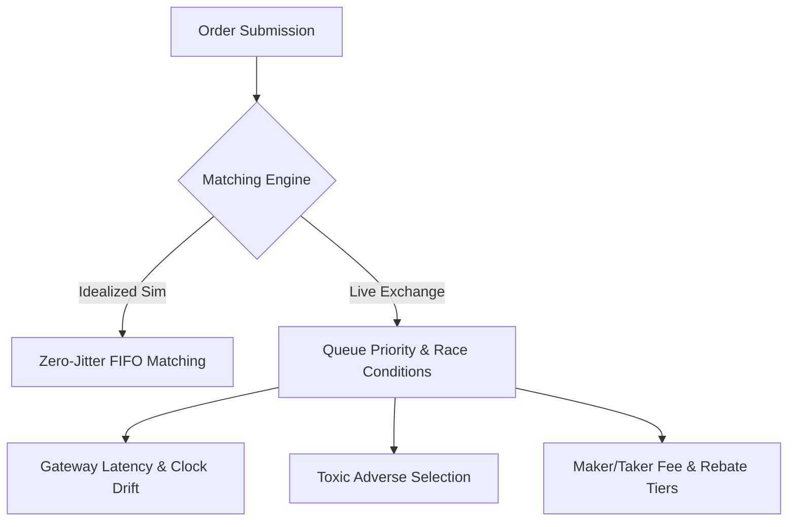

# Microstructure Reality Audit: Simulation vs. Live Exchange Mechanics

> [!IMPORTANT]
> This document audits where the ZERENE simulation platform makes simplifying assumptions versus real-world Level 2 / Level 3 exchange operations (NASDAQ ITCH/OUCH, CME MDP 3.0, Binance Spot/Futures).

---

## 1. Executive Summary

Research and backtesting simulators often abstract away harsh market plumbing. While ZERENE implements high-speed deterministic matching with Price-Time priority, several key differences exist between idealized synthetic simulations and live order execution.

---

## 2. Structural Discrepancies & Audit Findings

### 2.1 Latency Jitter & Timestamp Ordering
* **Simulator Assumption**: In basic simulations, orders arrive in discrete discrete time steps ($dt$) with instantaneous internal priority updates.
* **Exchange Reality**: Real matching engines process events strictly at the matching engine network interface card (NIC). Latency is heavy-tailed (log-normal or generalized Pareto), meaning that cancel commands often lose races to aggressive taker market sweeps (the "cancel race").
* **ZERENE Mitigation**: ZERENE provides [`LatencyGateway`](file:///d:/zerene/zerene/latency/gateway.py) and [`SIPFeedSimulator`](file:///d:/zerene/zerene/latency/sip_simulator.py). Ensure strategy evaluations route orders through `LatencyGateway` rather than submitting directly to `MatchingEngine`.

### 2.2 Adverse Selection & Queue Position Loss
* **Simulator Assumption**: Fill probability models often assume uniform drain of the price level queue.
* **Exchange Reality**: Toxic market orders arrive precisely when informed flow predicts a quote revision. Limit orders at the best bid/ask get filled disproportionately often *right before* the price crashes through them, whereas fills are scarce when the price is about to rally.
* **ZERENE Mitigation**: Use [`OrderQueueEstimator`](file:///d:/zerene/zerene/execution/queue_model.py) and incorporate OFI (Order Flow Imbalance) conditioning in synthetic flow to model aggressive toxic runs.

### 2.3 Modify / Cancel Queue Priority Dynamics
* **Live Exchange Rule**:
  * Modifying an order to *reduce* quantity preserves FIFO queue priority in NASDAQ, CME, and crypto exchanges.
  * Modifying an order to *increase* quantity or change price loses queue priority and moves the order to the end of the FIFO queue.
* **ZERENE Audit**: Verified! [`OrderBook.modify_order`](file:///d:/zerene/zerene/orderbook/book.py) strictly enforces priority preservation on down-sizing and queue demotion on up-sizing or price revision.

### 2.4 Empirical Calibration Gap
* **Previous Gap**: Initial synthetic generators used uncalibrated Hawkes process parameters ($\mu, \alpha, \beta$) and arbitrary Kyle's Lambda numbers.
* **Current Solution**: The [`zerene.calibration`](file:///d:/zerene/zerene/calibration/__init__.py) package provides:
  1. **Maximum Likelihood Hawkes Calibrator**: Fits $\mu$, $\alpha$, and $\beta$ directly from exchange tick arrival timestamps.
  2. **Kyle's Lambda & Square-Root Impact Calibrator**: Estimates price impact per unit traded from historical execution logs.
  3. **Stylized Facts Verifier**: Verifies excess kurtosis (fat tails), volatility clustering (autocorrelation of $|r_t|$), and bid-ask bounce (negative lag-1 return autocorrelation).

### 2.5 Benchmark Reproducibility
* **Previous Gap**: Unseeded `random.random()` calls produced different execution paths and latency profiles across repeated runs.
* **Current Solution**: Both [`BenchmarkRunner`](file:///d:/zerene/zerene/benchmarks/runner.py) and [`ShardedBenchmarkRunner`](file:///d:/zerene/zerene/benchmarks/sharded_runner.py) take an explicit `--seed` parameter to guarantee deterministic, bit-for-bit reproducible results across machines.
